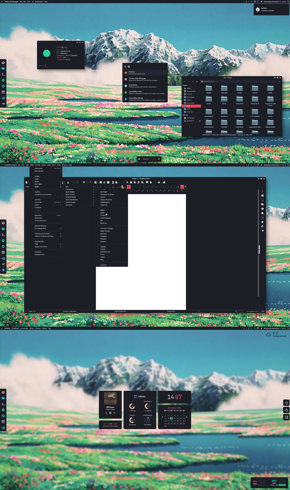

# Dotfiles

Arch Linux dotfiles 

### Dependencies

+ `awesome-git` - Window manager
+ `picom` - Compositor
+ `playerctl` - Get media player information
+ `imagemagick` - Blur images
+ `ttf-jetbrains-mono` and `ttf-roboto` - Fonts
+ `ttf-jetbrains-mono-nerd` - Icons
+ `lxqt-policykit` - Polkit agent
+ `appmenu-gtk-module` and `libdbusmenu-glib` - AwesomeWM global menu (for setup see instructions in [globalmenu.lua](.config/awesome/widgets/topbar/globalmenu.lua)) 

### Honorable mentions

The borders and anti-aliased corners are based on the [awesome-wm-nice](https://github.com/mut-ex/awesome-wm-nice/) repository. 

The animations are made with [Rubato](https://github.com/andOrlando/rubato/).